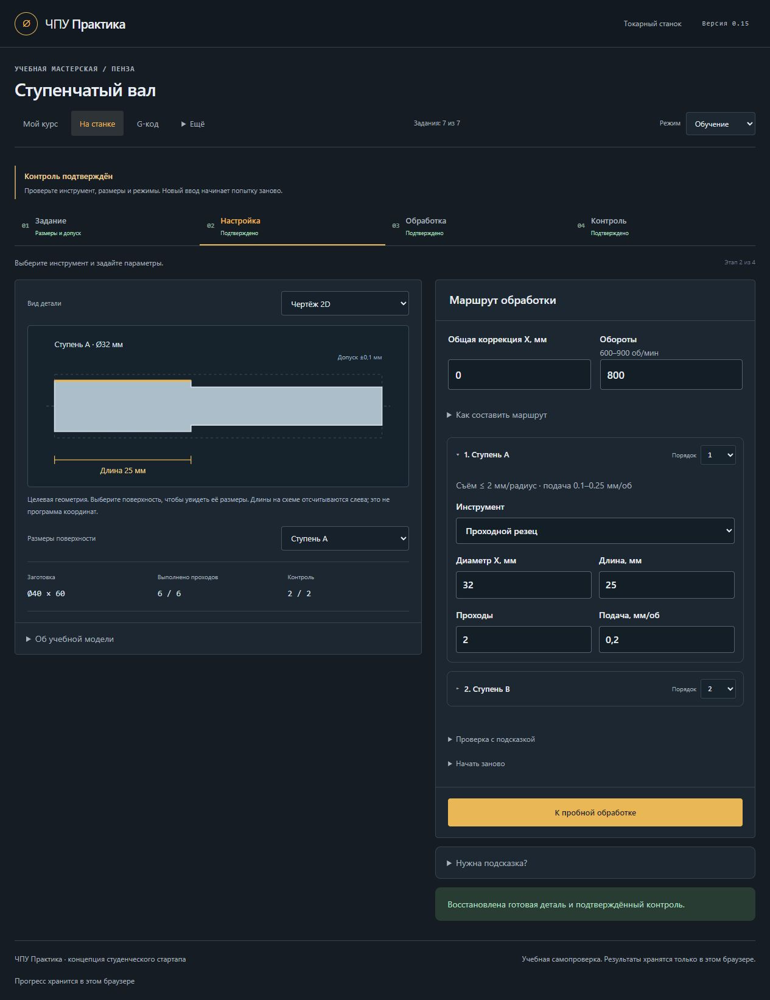

# Упрощение интерфейса — 0.15

Убрано дублирование управления в блоке заданий на станке. Основное действие находится в панели текущего этапа, рядом с параметрами или результатом. Наверху остаётся короткий статус попытки и линия четырёх этапов, позволяющая вернуться к заданию или настройке.

## Что заменено

| Было | Стало |
| --- | --- |
| Обучение / экзамен — две кнопки | Список «Режим» |
| Пять основных пунктов навигации и отдельное меню | Три основных пункта; остальные разделы в «Ещё» |
| Чертёж / сравнение / 3D — ряд кнопок | Список «Вид детали» |
| По кнопке на каждую поверхность | Список «Размеры поверхности»; скрыт для единственной поверхности и на этапе контроля |
| Целевая / обрабатываемая деталь — две кнопки 3D | Список «Деталь в 3D», видимый только в соответствующем режиме |
| Четыре ракурса и три кнопки масштаба | Список ракурсов и ползунок масштаба |
| Четыре кнопки сложности | Список рядом с поиском и фильтром прогресса |
| «Раньше» / «Позже» на каждой операции | Выбор места операции в маршруте |
| Кнопка выбора или повторения замера у каждой точки | Один список «Точка контроля» и статический план с отметками |
| «Все задания», «Назад» и действие в верхней панели | Раздел «На станке», линия этапов и действие в рабочей панели |
| Одновременно запуск и пошаговое выполнение | Выбор способа обработки и одна кнопка запуска / следующего шага / паузы |

Проверка с подсказкой, начало заново и просмотр выполненных проходов находятся в раскрываемых пунктах. Проверка остаётся помощью по прежним правилам. Самостоятельное выполнение не требует предварительной проверки.

На контроле сохранены отдельные кнопки «Измерить» и «Записать замер» / «Подтвердить контроль»: это разные действия ученика. Дублирующая кнопка следующего действия во время неподтверждённого контроля скрыта. После зачёта появляется переход дальше; для незаконченной обработки и ошибочных параметров остаётся действие возврата к нужному этапу.

## Поведение и совместимость

Выбор режима вызывает прежние контроллеры. Старые идентификаторы управляющих узлов сохранены для интеграции; скрытые элементы не входят в обычную навигацию клавиатурой. Этапы доступны кнопками линии прогресса, мышью и клавиатурой. Все новые списки имеют подписи. У 3D остаются вращение перетаскиванием, стрелки, колесо и клавиши масштаба; Home возвращает исходный вид, включая отключение разреза.

Изменение порядка операций сохраняет введённые параметры и начинает попытку с новой заготовки, как раньше. Меняется порядок операций, а не расположение поверхностей на детали. Смена способа обработки ставит движение на паузу, затем позволяет продолжить другим способом. Просмотр уже выполненных проходов доступен ползунком в раскрываемом пункте.

Новые действия обучения и раскрываемые пункты сброса скрыты в экзамене. Переключение режима сохраняет предусмотренный ранее черновик экзамена. Схемы, модели обработки, контроль допусков, семь заданий, уроки, справочник и G-код сохранены. Версия 0.14 остаётся отдельным файлом.

## Проверка

- `npm test`: 13 существующих наборов тестов моделей и восстановления.
- В браузере: базовый проход с автоматическим запуском, паузой, продолжением по шагам, измерением и явным подтверждением вывода.
- Ступенчатый вал: изменение порядка через список, автоматическая обработка шести проходов, оба замера без дублирующего верхнего действия; после перезагрузки первый замер из двух сохранился, второй завершил контроль без обязательной предварительной проверки маршрута.
- Конус: выбор точки у начала дал 31,40 мм; запись отключена до выбора вывода. Проверены выбор 3D, продольного разреза и масштаба.
- Проверены сложность вместе с фильтром прогресса, пустая выдача, меню «Ещё», доступ к справочнику, переключение в экзамен и скрытие действий обучения после его запуска.
- Незавершённый простой проход на этапе контроля предлагает вернуться к обработке. При семи зачтённых заданиях переход «К списку заданий» открывает каталог.
- Проверены настройка, контроль и каталог на узком экране: фактическая ширина 375 px, горизонтального переполнения нет. Исправлено наследование старой мобильной сетки навигации.
- В проверенных сценариях ошибок в журнале браузера нет. Автономная сборка проверяется отдельно от исходной страницы.

Для дополнительного ревью через ранее настроенный Aegis OpenRouter использована модель `google/gemini-3.8-flash`: 14 039 токенов, $0,01156125 по ответу API. Переданы три файла интерфейса, без ключей и пользовательского прогресса. Модель предположила обязательность предварительной проверки маршрута; это не подтвердилось кодом и полным прохождением в браузере. Закрытые пункты помощи оставлены закрытыми намеренно. Решения по интерфейсу и проверка сделаны локально; внешние API для запуска приложения не нужны.

Изменение относится к представлению и управлению. Физическая модель станка и ограничения учебного расчёта не расширялись.
