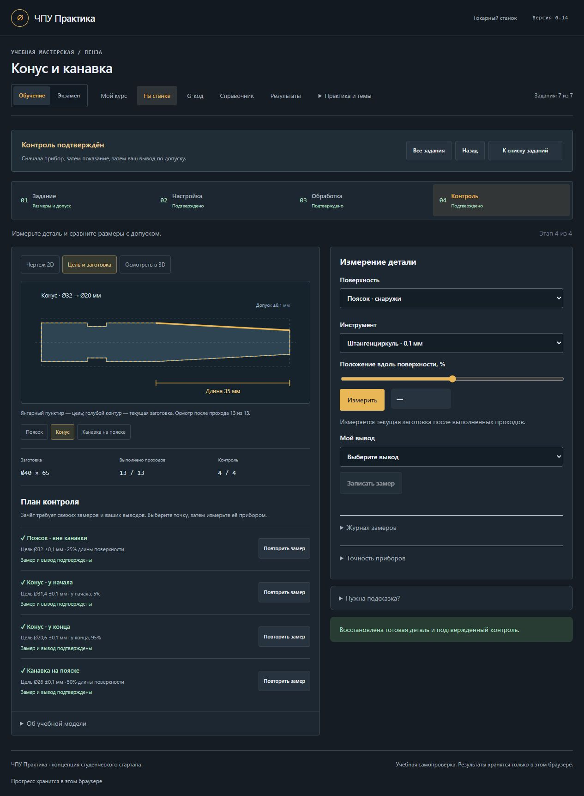

# Задания на станке — версия 0.14

Переработаны выбор детали и прохождение семи упражнений. Раньше каталог почти не показывал геометрию, рабочий экран слабо связывал чертёж и контроль, а после перезагрузки маршрута терялись замеры. Теперь ученик видит деталь, текущий этап, состояние заготовки и конкретные оставшиеся точки контроля.

## Вид и навигация

- «На станке» находится в основной навигации. Карточки показывают профиль детали, заготовку, учебную цель, сложность, число поверхностей и контрольных точек.
- Поиск по названию, навыку и поверхности сочетается с фильтрами сложности и прогресса. Рекомендация выбирает первое задание без подтверждённого зачёта текущих правил.
- Рабочий экран сохраняет четыре этапа: задание → настройка → обработка → контроль. Основная кнопка меняется по текущему состоянию: выполнить проход, выбрать точку, измерить, записать свой вывод или продолжить обучение.
- Есть размерная схема 2D, наложение целевой и текущей геометрии и прежний 3D-осмотр. Размеры получены из тех же моделей, что рассчитывают обработку. Схемы не являются отдельными декоративными картинками.
- Указаны исходная заготовка, выполненные проходы и число подтверждённых точек. Выбор поверхности меняет размерную подпись; последний замер отмечается на схеме.
- На узком экране панели располагаются в один столбец. План контроля показывается на этапе контроля; дополнительные пояснения остаются свёрнутыми.

## Что изменилось в работе ученика

План контроля помогает выбрать поверхность и место измерения. Он не измеряет деталь автоматически и не выбирает ответ «В допуске». После каждого нового показания необходимо самому выбрать вывод. До этого запись и подтверждение недоступны.

| Задание | План контроля |
| --- | --- |
| Первый проход | Один замер обработанного участка |
| Коррекция инструмента | Один замер обработанного участка после исправления коррекции |
| Режим обработки | Один замер после выбора подачи и оборотов |
| Ступенчатый вал | Отдельный замер каждой из двух ступеней |
| Полая втулка | Наружная поверхность и отверстие; неподходящий прибор отклоняется |
| Конус и канавка | Поясок вне канавки, конус у начала и конца, дно канавки |
| Вал по контрольным замерам | Три ступени; таблица пробных показаний доступна рядом с настройкой коррекции |

Для пояска точка находится на 25% длины, вне канавки. Для конуса выбраны 5% и 95%: цели в этих сечениях составляют Ø31,4 и Ø20,6 мм, а не диаметры торцов Ø32 и Ø20. Эти точки согласованы с существующей проверкой концов конуса.

Само завершение анимации не даёт зачёт. Нужны правильные параметры, обработка и свежие подтверждённые измерения нужных поверхностей. Просмотр чертежа и переход между экранами также не дают зачёта. Проверка настроек и подсказки сохраняют прежний учёт помощи.

## Попытки и восстановление

- Текущий контроль отделён от прежнего зачёта. Изменение параметров начинает обработку новой заготовки и сбрасывает доказательства текущей попытки; сохранённое достижение остаётся в истории.
- Старые отметки без `controlVersion: 1` сохраняются с пометкой, но не учитываются как подтверждённые текущими правилами при поиске и рекомендации.
- Этап каждого задания хранится в `cnc-machine-path-v1`. Восстанавливаются только известные задания и целочисленные этапы 0–3.
- Сессии маршрутов сохраняют версию, просмотренный и достигнутый проходы, показания и выбранные ответы. При загрузке показания пересчитываются для соответствующего состояния детали; повреждённые и несовместимые записи отбрасываются. Верность ответа не принимается из сохранённого флага.
- Пересмотр ранее выполненного прохода не удаляет журнал готовой детали. Экран явно показывает режим осмотра; можно вернуться к последнему выполненному проходу.
- Прежние сессии только с номером прохода открываются без выдуманных замеров. Для трёх начальных заданий восстанавливаются настройки и этап, но сам простой проход после перезагрузки выполняется заново.
- Новые подсказки о текущем состоянии скрыты в экзамене. Порядок сдачи экзаменов не изменён.

## Проверка

Автоматическая проверка: `npm test`, 13 наборов. Добавлен `tests/machine.test.cjs`: геометрия семи деталей, поиск и рекомендации, выбор точек вне канавки, оба конца конуса, отделение исторического зачёта от текущего контроля, устаревшие замеры, восстановление журнала и отклонение несогласованных показаний. Проверяется генерация схем без нечисловых координат. Автономный HTML собирается командой `npm run build:demo`, книга — `npm run build:handbook`.

В браузере пройдены все семь заданий от настройки до подтверждённого контроля. Дополнительно проверены:

- невозможность записи до выбора собственного вывода;
- запрет раннего контроля простого прохода;
- сброс текущего контроля после изменения настроек при сохранении исторического зачёта;
- перезагрузка ступенчатого вала после первого из двух замеров и завершение второго;
- возврат с готовой детали к предыдущему проходу и обратно без потери журнала;
- отклонение наружного микрометра при измерении отверстия втулки;
- четыре разные точки контроля конуса с канавкой;
- восстановление готовой детали и трёх замеров калибровочного вала;
- поиск, пустая выдача и фильтры «Требуют зачёта» / «Зачтённые»;
- скрытие новых панелей в экзамене;
- каталог и рабочий экран при узкой ширине: фактическая ширина страницы 375 px, горизонтального переполнения нет;
- отсутствие ошибок в журнале браузера в проверенных сценариях.

## Участие OpenRouter

Для дополнительного обзора изменений использована модель `google/gemini-3.8-flash` через ранее настроенный в Aegis OpenRouter. Переданы исходники для ревью, без ключей и пользовательского прогресса. По ответу API: 14 298 токенов, стоимость $0,0116265. Замечания проверены по коду и в браузере: предположения об утечке экзамена и бесконечном цикле не подтвердились. Добавлена полезная защита от повторного переключения уже выбранного вида, чтобы не сбрасывать текущий замер. Внешний API не требуется для работы тренажёра.

## Границы изменения

Упражнения используют прежнюю учебную модель снятия материала. Не добавлены расчёт столкновений, силы резания, износа, реального закрепления или шероховатости. Размерная схема отсчитывает длины слева и прямо подписана как схема, а не координатная программа. Данные остаются локальными; повторная проверка журнала помогает восстановлению, но не превращает самопроверку в защищённую аттестацию.

Новые файлы: `machine-model.js`, `machine-graphics.js`, `machine-ui.js`, `tests/machine.test.cjs`. Подключение и сохранение интегрированы в существующие контроллеры; предыдущие курсы, G-код, справочник и практикум включены в сборку.
