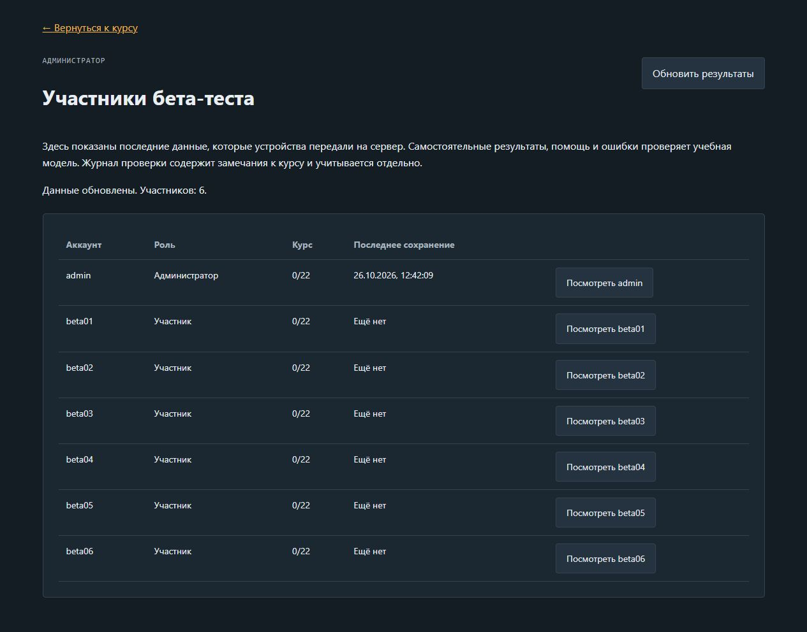

# ЧПУ Практика

Учебный тренажёр наладки токарного станка с ЧПУ: обучение, планирование обработки и самопроверка. Версия 0.21.0 концепции студенческого стартапа для подготовки технических кадров Пензенской области.



## Закрытая серверная бета (0.21)

Node.js 24 + SQLite: один администратор и шесть заранее созданных участников, серверные сессии, автоматическое сохранение прогресса и наблюдений, кабинет администратора, защита входа от подбора, конфликты устройств, Docker + Caddy и ежедневные резервные копии.

```sh
npm run beta:init
npm run beta:start
```

Локальная серверная версия: **http://127.0.0.1:4180/**. Инициализацию выполняют один раз. Она сообщает путь закрытого файла с семью уникальными паролями; повторная команда их не сбрасывает. `npm start` на порту 4173 остаётся автономной версией для разработки, без авторизации. Аккаунтная версия требует Node.js 24.13 или новее в ветке 24.

[Как разместить на VPS](DEPLOY-0.21.md) · [Как организовать бету и зачем журнал](BETA-GUIDE-0.21.md) · [Реализация и проверки](SERVER-0.21.md).

Проверка: `npm test`, `npm run test:server`, обе сборки и `node scripts/check-build.cjs`. Локальные базы, пароли и `.env` не входят в исходники и Docker image. На новом сервере аккаунты создаются заново с новыми паролями.

## Исправления интерфейса (0.20.1)

Исправлен белый фон панели экзамена. Журнал доступен напрямую: **Ещё → Журнал проверки**; кнопки скачивания наблюдений и отчёта видны наверху. [Подробности и проверка](FIXES-0.20.1.md).

## Проверка курса перед пилотом (0.20)

В результатах появился отдельный журнал этапа E: самостоятельный прогон, шесть пунктов проверки содержания, конкретные затруднения, помощь и подбор незнакомых заданий через 3–7 дней. Чтение JSON участника не переносит ответы в курс; наблюдения сохраняются отдельно. Самопроверки не входят в показатели новичков.

20 наборов тестов и обе автономные сборки проходят. Наблюдения за реальными новичками и проверка преподавателем ещё предстоят. [Как начать самому](PILOT-0.20.md) · [Что сделано и проверено](PILOT-TOOLS-0.20.md).

## Общие результаты и перенос (0.19)

«Ещё → Результаты» собирает обязательные 22 шага и самостоятельные итоги, помощь и исправления, дополнительные задания, навыки, чтение и экзамены. Один JSON переносит все 11 разделов, текущие черновики и разные истории решений; отдельная TXT-сводка подходит для преподавателя.

Перед импортом показаны изменения. Начатая местная работа сохраняется, отсутствующие задачи добавляются, истории не склеиваются в искусственный самостоятельный зачёт. Есть предыдущая копия и восстановление после прерванной записи. Повреждённый архив отклоняется целиком. Прежние JSON-файлы практикума поддерживаются. Пустые поля и неподтверждённые прогнозы тоже сохраняются.

Все 18 наборов тестов и браузерные сценарии переноса пройдены. Подготовлены CI и автономные сборки. [Реализация и проверки](PROGRESS-0.19.md) · [Запуск локального пилота и QA](PILOT-0.19.md). Публичная публикация и наблюдения за новичками ещё предстоят.

## От обработки к программе (0.18)

Путь расширен до 22 шагов. После полного цикла идут шесть связанных тем G-кода и программа для другого чертежа. Перед исполнением и проверкой ученик предсказывает результат строки своего текущего кода: координаты, движение, подачу или состояние шпинделя. Редактирование отменяет подтверждение прогноза. Ошибки ведут к подходящему объяснению рядом с сохранённой программой.

Всего 11 условий G-кода, включая три новых итоговых. Проверка оценивает движения и состояния, принимает эквивалентную запись. Помощь и ошибки сохраняются при сбросе; самостоятельный итог подтверждают на другом условии. Старые зачёты сохранены, но не заменяют новый итог. Общий экспорт разделов ещё предстоит в этапе D.

Все 16 наборов тестов пройдены; новый отрезок проверен в браузере до 22/22 с ошибкой, разбором, сменой условия и восстановлением после перезагрузки. Реализация, ограничения модели и участие OpenRouter — [GCODE-COURSE-0.18.md](GCODE-COURSE-0.18.md).

## Полный цикл и самостоятельная работа (0.17)

Учебный путь расширен с 9 до 15 шагов. После первого размера идут подготовка, черновой/чистовой припуск, режимы и распределение проходов, затем полный цикл с разбором и другой чертёж без помощи. Новый экран показывает карту детали и текущее действие: подготовить, обработать, измерить или подтвердить результат. Проходы продолжают снимать материал с той же заготовки. Предыдущий замер не подтверждает поверхность после нового прохода.

Для самостоятельного подтверждения добавлены три условия: большой припуск с двумя черновыми проходами, небольшой запас до цели и меньшая допустимая глубина. X, прогноз и инструмент ученик выбирает сам. Помощь, ошибки и факт повтора сохраняются на уровне условия. Прежний успешный результат остаётся достижением, а текущая заготовка проверяется отдельно.

Импорт объединяет журналы без дубликатов, сохраняет обе истории и учитывает самостоятельное решение. Повреждённый архив отклоняется целиком. Старый JSON версии 1 поддерживается; новые сохранения используют cnc-deep-training-v2 и не перезаписывают прежнее хранилище. Перенос через JSON относится к практикуму; общий перенос всех разделов запланирован отдельно.

Всего в практикуме 12 условий: 6 полного цикла, 3 распределения припуска и 3 диагностики коррекции. Подробности, ограничения и проверки — [FULL-CYCLE-0.17.md](FULL-CYCLE-0.17.md). Это этап B из [MVP-PLAN.md](MVP-PLAN.md); следующий этап связывает задачи G-кода с курсом.

## Первый связанный модуль MVP (0.16)

«Мой курс» теперь ведёт по девяти обязательным шагам: устройство станка, остановка перед ручным контролем, резец, диаметр, координаты, первый проход, смысл измерения, допуск и контроль своей детали. Кнопки продолжения связывают уроки и станок; будущие шаги открываются по мере прохождения. Прежние подтверждённые результаты учитываются.

Первый проход знакомит только с конечным X. Инструмент, коррекция, подача и обороты подготовлены и объяснены рядом с полем. Такой проход отмечается как выполненный с помощью. Полная панель остаётся в обычных заданиях. После обработки ученик читает два коротких урока, возвращается к той же детали, измеряет её и подтверждает вывод. Итог модуля предлагает перейти к подготовке станка.

Для трёх базовых заданий сохраняются настройки, готовая деталь, замер, подтверждённый вывод и помощь. При восстановлении показание и вывод заново проверяются моделью. Смена прибора/поверхности, новые настройки и новый проход отменяют текущий контроль; исторический зачёт сохраняется. Незаконченный базовый проход после перезагрузки выполняют заново.

Это реализация этапа A из [MVP-PLAN.md](MVP-PLAN.md). Полный цикл, новые самостоятельные условия и общий перенос прогресса относятся к следующим этапам. Проверки и участие моделей OpenRouter описаны в [LEARNING-PATH-0.16.md](LEARNING-PATH-0.16.md).

## Упрощённое управление (0.15)

Три основных раздела — «Мой курс», «На станке» и «G-код». Справочник, результаты, все уроки, навыки и практикум открываются через «Ещё». Обучение и экзамен выбираются списком «Режим» на рабочем экране.

Вместо рядов кнопок используются списки: вид детали, поверхность для размерной схемы, точка контроля, ракурс 3D, сложность и место операции в маршруте. Масштаб 3D регулируется ползунком. Четыре этапа оформлены как спокойная линия прогресса; верхняя панель больше не повторяет действия справа.

Основная кнопка находится рядом с полями текущего этапа. В обработке выбирается «По шагам» или «Автоматически», одна кнопка запускает, продолжает или ставит процесс на паузу. В контроле сохранены два разных действия: измерить и подтвердить свой вывод. Переход дальше появляется после зачёта. Проверка с подсказкой, сброс и осмотр предыдущих проходов раскрываются по запросу. Подробнее — [INTERFACE-0.15.md](INTERFACE-0.15.md).

## Задания на станке (0.14)

Раздел «На станке» вынесен в основную навигацию. Семь заданий представлены карточками с профилями деталей, учебной целью, сложностью и числом точек контроля. Поиск сочетается с фильтрами сложности и зачёта; сверху предлагается следующее незачтённое задание.

В рабочем экране связаны четыре этапа: задание, настройка, обработка и контроль. Кнопка следующего действия учитывает состояние текущей попытки. Размерный чертёж 2D, сравнение цели с изготовленной заготовкой и прежний 3D-осмотр используют общие модели геометрии. План контроля выбирает поверхность и место измерения; сам замер и вывод остаются действиями ученика. У конуса две точки, замер пояска выбран вне канавки.

В маршрутах сохраняются выполненные проходы и журнал измерений; при восстановлении показания проверяются повторно по состоянию детали. Настройки новой попытки сбрасывают текущий контроль, а прошлый зачёт остаётся в истории. Простой проход после перезагрузки нужно выполнить заново. Подробности и проверка — [MACHINE-0.14.md](MACHINE-0.14.md).

## Практика G-кода (0.13)

Новый пункт «G-код»: восемь заданий от чтения одной координаты до небольшого учебного маршрута. Сначала объяснение с разбором, затем редактор и другое условие. Пошаговый просмотр показывает X/Z, G00/G01, подачу с единицами и состояние шпинделя. Проверка оценивает движения и состояния, принимает эквивалентную запись и объясняет ошибки по строкам. Есть отдельные черновики, сохранение решений и учёт подсказки.

Используется ограниченная токарная модель по материалам Haas: X по диаметру, абсолютные X/Z, G99 для мм/об. Это разбор траектории точки, без расчёта съёма и реальной кинематики быстрого хода. В справочнике теперь 25 статей и 42 термина. Подробности, проверка и источники — [GCODE-0.13.md](GCODE-0.13.md).
## Начало курса с нуля (0.12)

Первые четыре урока — без расчётов. В восьми базовых темах последовательность «Разобраться → Попробовать → Проверить»: объяснение простыми словами, разбор рассуждения, действие со схемой и отдельная проверка. Во всех 24 уроках вопрос больше не стоит рядом с готовым примером. Диаметр, допуск, оси и подача вводятся постепенно; после первой ошибки предусмотрена подсказка. Старые ответы сохранены, текущий шаг восстанавливается отдельно. Подробности и границы изменения — [COURSE-0.12.md](COURSE-0.12.md).
## Проверка заданий (0.11)

Каждое из семи упражнений получило учебную цель, предварительные знания, обоснование сложности и критерии зачёта. В каталоге различаются начальный, начальный+, средний, средний+ и сложный уровни внутри прежних трёх групп фильтра.

Анимация больше не завершает упражнение: нужен свежий контроль нужных поверхностей и верный вывод. Для конуса проверяются оба конца; замер в канавке не подтверждает поясок. Исправленные неверные выводы в практикуме учитываются отдельно от самостоятельного результата. Зачёты предыдущих версий сохранены с пометкой.

Полная оценка семи упражнений, девяти вариантов практикума, 12 тем карточек и 24 проверок уроков — [TASK-AUDIT-0.11.md](TASK-AUDIT-0.11.md).

## Оформление «Мастерская» (0.10)

Выбран тёмный технический вариант: графитовый фон, янтарные основные действия, строгие панели, схемы и таблицы с читаемым контрастом. Тема вынесена в workshop-theme.css и включается в автономную сборку.

Новый экран «Мой курс» показывает кнопку начала или продолжения и ориентир от устройства станка до контроля детали. Кнопка открывает первый непройденный урок, сохраняя прежние ответы. Навыки, практикум и задания собраны в меню «Практика и темы». Список уроков и дополнительное чтение свёрнуты, после верного ответа выделяется следующий урок. Подробности — [DEVELOPMENT-0.10.md](DEVELOPMENT-0.10.md).

## Навыки и расширение базы (0.9)

Новый раздел «Навыки» — 12 тем и 144 варианта карточек: съём на радиус, чистовой припуск, число проходов, подача, время, коррекция, допуск, округление замера, координаты, модальность, маршрут и готовность станка. В числовых темах меняются исходные данные. Ситуационные вопросы повторяются с перестановкой ответов: всего 118 разных условий; один и тот же сюжет не выдаёт дополнительные подтверждения освоения.

- Освоение темы: три разных задания подряд, верно с первой попытки без помощи. Ошибка или решение после подсказки прерывают серию; прежде освоенная тема получает статус «Повторить».
- Рекомендация следующей темы учитывает необходимость повторения и незавершённое освоение. Из карточки можно перейти к нужной статье; это учитывается как помощь.
- Смешанная контрольная: 12 вопросов, один на навык. Ответ фиксируется один раз. До окончания нет оценок и решений, после — разбор каждого ответа и переход к повторению.
- Незавершённая контрольная и черновик восстанавливаются после перезагрузки. Отдельное хранилище cnc-skills-v1 не меняет старые уроки и результаты практикума. Есть скачивание отчёта TXT.
- Курс: 24 урока. Справочник: 24 статьи и 38 терминов. Новые темы — рабочий ноль, приращения, таблица состояний программы, проверка первого изделия, требования к поверхности и несколько сечений контроля.

Это локальная самопроверка, не защищённый экзамен и не аттестация оператора. История хранит последние пять разборов контрольных; журнал восстановления ограничен 10 000 действиями. Подробности реализации, проверки и участия OpenRouter — в [DEVELOPMENT-0.9.md](DEVELOPMENT-0.9.md).

## Учебная база и справочник (0.8)

Курс «С нуля» расширен с 8 до 20 уроков. Добавлены наладка, черновая/чистовая обработка, расчёт проходов и времени, скорость резания, диагностика коррекции, округление показаний, модальность, зависимости маршрута, материал, брак и журнал измерений. Ответы старых восьми уроков сохраняются без начисления результатов за новые.

Раздел «Справочник» содержит 18 авторских статей (около 3300 русских слов) и словарь из 30 терминов. В статьях есть последовательные объяснения, примеры, контрольные вопросы/проверки рассуждений и ссылки на официальные материалы Haas, Sandvik Coromant и Mitutoyo. Это учебные конспекты, а не перепечатка руководств.

- Поиск по тексту, названиям, тегам и названиям источников, без различия регистра и е/ё.
- Тематические разделы, закладки и отдельный фильтр прочитанного.
- Содержание каждой статьи, ссылки на соответствующие уроки и продолжение чтения.
- Кнопки «Читать подробнее» во всех 20 уроках. Из практикума можно открыть справку о проходах или измерениях, сохранив состояние детали; такое адресное обращение считается помощью.
- Скачать отдельную статью как TXT. Чтение не выдаёт зачёт за практическое задание.
- Выбранная статья и отметки хранятся отдельно под ключом cnc-library-v1. При недоступном хранилище чтение продолжает работать.

Автономное приложение demo/cnc-demo.html включает библиотеку целиком. Отдельная книга demo/cnc-handbook.html содержит все статьи, словарь, содержание и ссылки. Её можно читать без запуска приложения и распечатать средствами браузера. Внешние источники требуют интернета и преимущественно представлены на английском языке; отдельные ресурсы предлагают PDF или регистрацию.

Пересборка книги: npm run build:handbook. Проверки данных библиотеки входят в npm test. Подробности проверки и участия моделей — в [DEVELOPMENT-0.8.md](DEVELOPMENT-0.8.md).

## Углублённый практикум (0.7)

Раздел «Практикум» содержит три группы по три варианта: первый полный цикл, распределение большого припуска и диагностика постоянного смещения X. Новые сценарии дополняют семь существующих упражнений.

- Подготовка: закрепление, установка нуля на торце, дверь и шпиндель. Модель блокирует запуск без подготовки, открытие двери при вращении, освобождение заготовки за закрытой дверью и ручной замер при включённом шпинделе.
- Один проход требует выбора чернового или чистового этапа и прогноза конечного диаметра. Отдельные пределы глубины и подачи действуют для каждого этапа.
- Диаметр сохраняется после каждого прохода. Программирование большего X не возвращает материал. Съём ниже допуска создаёт брак, который требует новой заготовки; предыдущая попытка остаётся в журнале.
- В задаче на припуск нужно самостоятельно разбить съём на несколько проходов. Перед первым чистовым обязательно оставить предусмотренный припуск, а не просто однажды выполнить любой черновой проход.
- В задаче на коррекцию представлены три контрольных замера пробной детали. Для зачёта нужны правильные причина и коррекция, а не только конечный размер.
- Калькулятор показывает скорость резания, минутную подачу и теоретическое время по программному X. Фактическое расчётное время выполненных проходов суммируется отдельно.
- Контроль учитывает интервал округления прибора. Для пограничного показания есть вывод «Нужно уточнить». Финальное подтверждение требует свежего замера микрометром и верного вывода после последнего прохода.
- Незавершённые критерии предлагают вернуться к подходящей теме вводного курса. Состояние детали сохраняется; открытие темы учитывается как помощь.
- Разбор содержит прогнозы, размеры до и после, глубину каждого прохода, замеры, блокировки и предыдущие заготовки. Самостоятельный результат требует верных прогнозов, отсутствия подсказок и заблокированных действий текущей попытки.
- Обновлена и метрология прежней маршрутной мастерской: вывод теперь основан на показании и его округлении, а не на скрытом точном размере модели.

### Первый полный цикл, вариант 1

1. Закрепите заготовку, установите ноль, закройте дверь и включите шпиндель.
2. Черновой: X = 28,4; коррекция = 0; подача = 0,20; обороты = 800; прогноз = 28,4. Выполните один проход.
3. Чистовой: X = 28; подача = 0,12; прогноз = 28. Выполните проход.
4. Остановите шпиндель, перейдите к контролю и сделайте замер микрометром.
5. Выберите «В допуске» и отсутствие причины для коррекции, подтвердите вывод. Разбор показывает все семь обязательных критериев.

### Сохранение и перенос

Состояние нового практикума хранится отдельно: cnc-deep-training-v1. Сохраняются выбранный вариант, этап, поля настройки, действия, проходы и замеры. После перезагрузки открывается прежний раздел. Экзамен сохраняет приоритет своего режима.

«Сохранить прогресс в JSON» переносит журнал на другое устройство. Импорт принимает файлы до 1 МБ, проверяет все журналы целиком и пересчитывает состояние из действий. Повреждённый файл не меняет текущую работу; объединение сохраняет ранее зачтённые локальные варианты. «Скачать отчёт преподавателю» выгружает текст по всем начатым вариантам, включая действия и ошибки. Это локальная самопроверка без серверной аттестации и защиты от намеренного редактирования.

Практикум моделирует один наружный цилиндрический участок с продольным проходом. Кнопки подготовки проверяют последовательность, но не рассчитывают надёжность реального закрепления. Время — только резание; износ, силы, разгон, столкновения и метрологическая погрешность сверх округления не рассчитываются. Числовые режимы — условия упражнений, а не производственные рекомендации.

## Обучение с полного нуля (0.6)

Кнопка «С нуля» открывает восемь уроков: устройство токарного станка, безопасное действие, диаметр и припуск, X/Z, допуск, инструмент, подача и контроль. В каждом уроке есть объяснение, пример и проверка понимания. Для устройства станка, координат и радиального съёма добавлены схемы. Числовой ответ принимает точку и запятую.

При первом входе и пока курс не завершён открываются основы с первого непройденного урока. Можно читать уроки в любом порядке и в любой момент перейти к «Первому проходу». После верного ответа открывается следующий шаг. Прогресс основ хранится отдельно в localStorage под ключом cnc-foundations-v1; результаты практики и экзаменов сохраняются как раньше. Это локальная учебная отметка, а не защищённая аттестация. При отказе хранилища курс работает до закрытия страницы и предупреждает о невозможности сохранения.

Маршрутный экзамен теперь получает явный результат «Зачтено» / «Не зачтено». Для зачёта обе детали должны выполнить все условия модели и получить от 80 баллов каждая. Ошибки инструмента, геометрии, режимов, глубины, коррекции или порядка ограничивают оценку детали 59 баллами. Расчётные баллы по категориям остаются видимыми для разбора; высокий средний балл не заменяет обязательные условия. История и текстовый отчёт показывают новый статус. Сохранённые ответы прошлых попыток пересчитываются по новым правилам.

Вводные уроки объясняют основы; физическая модель закрепления, полный пульт управления, столкновения и произвольный G-код остаётся дальнейшим этапом. Реальная практика требует преподавателя и инструкции конкретного оборудования.

## Что работает

- Семь упражнений: три лёгких, два средних и два сложных; фильтр по уровню.
- Выбор инструмента и настройка X, коррекции X, подачи и оборотов.
- Проверка ошибок, последовательные подсказки и отметки о прохождении упражнений.
- Проход по четырём этапам: подход, установка X, обработка и отвод; пауза и переход к следующему шагу.
- Иллюстрация G-кода с подсветкой текущего этапа.
- Экзамен из трёх заданий с другими размерами детали, без подсказок и пробного запуска. Три варианта размеров чередуются между попытками.
- Один ответ на задание, итоговый балл, разбор ошибок и возврат к нужной теме.
- История последних десяти экзаменов, скачивание текстового отчёта и восстановление незаконченного экзамена.
- Интерфейс для компьютера и телефона.
- 3D-осмотр всех деталей: вращение мышью, касанием или стрелками; масштаб колесом, кнопками или клавишами +/−; виды сбоку, с торца, объёмный вид и продольный разрез.
- Сравнение целевой геометрии и размеров по своим настройкам, включая отверстие, ступени, конус и канавку.

**Нейросеть пока не подключена.** Наставник использует локальные правила и распознавание тем вопроса. API-ключи и внешние сервисы для запуска не нужны.

## Быстрый запуск

Откройте `index.html` в браузере. Все необходимые файлы находятся рядом.

Для передачи одним файлом используйте `demo/cnc-demo.html`: он содержит встроенные стили и скрипты и работает без интернета.

После правки исходников пересоберите его командой `npm run build:demo`.

Если установлен Node.js, можно запустить локальный сервер:

```sh
npm start
```

Откройте адрес `http://127.0.0.1:4173`. Устанавливать зависимости не требуется.

## Пошаговая мастерская

Обучение разделено на четыре экрана: **Задание → Настройка → Обработка → Контроль**. Слева остаётся модель, справа — текущий этап. Можно возвращаться между этапами без сброса параметров; уход с обработки ставит анимацию на паузу. Каталог открывается кнопкой «На станке», история — кнопкой «Результаты». Подсказки, G-код и журнал замеров раскрываются по запросу. В маршруте раскрыта одна операция; остальные доступны по заголовку. После перезагрузки восстанавливается выбранный этап. Для маршрутов также восстанавливаются выполненные проходы и проверенные замеры; простой проход трёх начальных заданий выполняется заново.

## Первое упражнение

1. Откройте «На станке», выберите «Первый проход» и перейдите к настройке.
2. Нажмите «Проверить настройки»: при исходном X = 30 мм останется припуск.
3. Установите X = 28 мм, коррекцию X = 0 мм, подачу 0,20 мм/об, обороты 800 об/мин и проходной резец.
4. Перейдите к этапу «Обработка» и выполните проход целиком или последовательно кнопкой «Следующий этап прохода».
5. Откройте «Контроль», измерьте обработанный участок, выберите вывод «В допуске» и подтвердите его. Зачёт требует завершённого прохода, верных настроек и подтверждённого контроля.

Для самостоятельного прохождения настройте параметры без проверки и подсказок. Режим «По шагам» разбирает тот же проход по этапам; во время движения настройки заблокированы. Проверка и помощь наставника отмечают текущую попытку как выполненную с помощью.

## Экзамен и сохранение

Базовый экзамен проверяет три лёгкие темы. Откройте вкладку «Экзамен» и нажмите «Начать экзамен». Для каждого задания настройте параметры и нажмите «Сдать ответ». После сдачи изменить ответ нельзя; оценка и объяснения появятся после третьего задания. Каждый верный ответ даёт треть итогового результата (0, 33, 67 или 100%). Для среднего и сложного уровня экзамен включает две детали с изменяемыми размерами. За каждую: точность — 40, технология — 25, порядок — 15, экономичность — 20 баллов. Каждый лишний проход снимает 2 балла экономичности, до нуля в этой категории. Итог — среднее двух деталей. Подсказки, измерения и пробные проходы отключены; ответы и подробный разбор доступны после обеих сдач. История маршрутов хранится отдельно под ключом `cnc-route-exams-v1`.

Прогресс и история хранятся в `localStorage` этого браузера; между устройствами не синхронизируются. Настройки незаконченного экзамена сохраняются при перезагрузке и переключении в обучение. При недоступном хранилище интерфейс предупреждает об этом. В режиме открытия файла сохранение зависит от настроек браузера.

Это самопроверка: серверной аттестации, учётных записей и защиты от изменения локальных данных нет.

## Новые детали и сложность

| Уровень | Деталь | Что требуется |
| --- | --- | --- |
| Средний | Ступенчатый вал Ø32 / Ø24, длина 60 мм | Рассчитать число проходов для каждой ступени из Ø40 с ограничением 2 мм на радиус |
| Средний | Втулка Ø30, отверстие Ø22, длина 45 мм | Выбрать расточной резец, обработать отверстие перед наружной поверхностью, выдержать стенку 4 мм |
| Сложный | Поясок Ø32, конус Ø32 → Ø20 и канавка Ø26 | Согласовать инструменты, режимы, проходы и порядок обработки пояска и канавки |
| Сложный | Вал Ø36 / Ø30 / Ø24 | Определить постоянное смещение +0,4 мм по трём замерам и компенсировать его общей коррекцией |

Место каждой операции выбирается списком «Порядок» в её заголовке. Порядок карточек задаёт технологическую последовательность; расположение поверхностей определяется заданием. Припуск условно распределён поровну между проходами. «Проверить маршрут» проверяет размеры, инструменты, режимы, глубину прохода, порядок и диагноз. «Запустить обработку» показывает последовательное снятие материала в 3D. Можно поставить паузу, выполнить следующий проход отдельно или осмотреть уже пройденные этапы ползунком. Пересмотр этапов не меняет результат зачёта. Изменение параметров возвращает исходную заготовку. Неверный инструмент и физически невозможная геометрия блокируют запуск; остальные ошибки можно исследовать на пробной детали. Зачёт выдаётся только после полного выполнения правильного маршрута.

Ошибочная проверка или открытая подсказка отмечает новую задачу как пройденную с помощью. Маршруты и подсказки хранятся локально под ключом `cnc-lab-v1`, общий прогресс — `cnc-practice-v2`. Прогресс версии 0.2 сохраняется.

3D-просмотр работает без внешних библиотек и сети: поверхности вращения строятся из размерного профиля и проецируются на canvas. Разрез открывает внутреннюю поверхность втулки; Home сбрасывает ракурс. Процесс учитывает текущий наружный профиль и отверстие: снятый материал не восстанавливается следующей операцией. Столкновения инструмента не моделируются. Незаконченная обработка восстанавливается до последнего завершённого прохода.

В измерительном блоке выберите поверхность, положение и прибор. Штангенциркуль округляет до 0,1 мм, наружный микрометр — до 0,01 мм и не измеряет отверстия. Место замера отмечается на 3D-детали. Сравните результат с допуском и запишите вывод; журнал последних 12 замеров действует в текущем сеансе задания. В лёгких упражнениях после прохода можно измерить обработанный участок и хвостовик. Приборы упрощены: случайная погрешность и сила прижатия не моделируются.

## Упрощения модели

- В обучении заготовка Ø32 мм, цель Ø28 ±0,1 мм, длина 45 мм. В экзамене размеры указаны в каждом задании.
- X и коррекция в демке задаются по диаметру: диаметр траектории = X + коррекция X.
- Учебные условия: подача 0,10–0,25 мм/об, обороты 600–1000 об/мин, съём до 2 мм на радиус за проход, правильная коррекция X = 0 мм.
- Анимация ускорена. Силы резания, шероховатость, деформация и полный цикл станка не моделируются.
- Показанный G-код служит иллюстрацией; интерпретатора произвольного G-кода нет.
- Учебные режимы и код не предназначены для применения на реальном оборудовании.

## Файлы

| Файл | Назначение |
| --- | --- |
| `index.html` | Разметка интерфейса и схема станка |
| `style.css` | Стили и адаптация к размеру экрана |
| `library-model.js` | Статьи, словарь, источники, поиск и отметки чтения |
| `library-ui.js` | Каталог справочника, чтение, закладки и связи с уроками |
| `scripts/build-handbook.cjs` | Автономная книга для чтения и печати |
| `training-math.js` | Числовой ввод, режимы и интервал округления прибора |
| `training-model.js` | Состояние детали, задания, зачёт, журналы и импорт |
| `training-ui.js` | Подготовка, проходы, контроль и отчёты нового практикума |
| `course-model.js` | Уроки основ, проверка ответов и восстановление прогресса |
| `course-ui.js` | Экран вводного курса, схемы и самостоятельная проверка |
| `model.js` | Упражнения, расчёты, проверка и ответы наставника |
| `lab-model.js` | Четыре новые детали, проверка маршрутов и размерные профили |
| `lab-ui.js` | Карточки операций, подсказки и сохранение маршрутов |
| `process-model.js` | Поэтапное снятие материала и виртуальные измерения |
| `lab-session.js` | Анимация, пауза, осмотр проходов и журнал замеров |
| `route-exam-model.js` | Варианты и оценка экзаменов по маршрутам |
| `route-exam-ui.js` | Сдача маршрутов, история и отчёты |
| `viewer3d.js` | Трёхмерные поверхности вращения и управление камерой |
| `workshop.js` | Навигация по этапам, каталог и отдельная история |
| `app.js` | Управление интерфейсом и анимацией |
| `scripts/serve.cjs` | Локальный сервер без зависимостей |
| `scripts/build-demo.cjs` | Сборка автономной HTML-версии |
| `tests/model.test.cjs` | Проверки учебной модели |
| `tests/exam.test.cjs` | Проверки экзамена, восстановления и этапов |
| `tests/lab.test.cjs` | Проверки новых деталей, проходов, инструментов, порядка и диагностики |
| `tests/process.test.cjs` | Геометрия проходов, замеры, оценка и восстановление маршрутного экзамена |
| `demo/cnc-demo.html` | Автономная версия в одном файле |

В браузерах с поддержкой WebMCP доступны чтение состояния и проверка выбранного учебного задания. Настройка через инструмент поддерживает три базовые темы; новые маршруты редактируются карточками. Во время экзамена настройка и проверка через инструменты недоступны, чтение состояния не раскрывает оценку.

## Проверки

Стили редактируются в `styles/`, затем собираются командой `npm run build:styles`.
Корневые CSS и `server/public/account.css` генерируются автоматически; проверка их
актуальности входит в `npm test`. Границы ответственности описаны в `styles/README.md`.
Для серверной версии дополнительно выполнить `npm run test:server`.

```sh
npm test
```

Проверяются правильный проход, исходные ошибки, чрезмерный съём, отсутствие резания вне заготовки, пересечение оси, инструмент, числовые ограничения и ответы наставника. Для экзамена проверяются все варианты, оценка, запрет повторной сдачи и неверного перехода, восстановление состояния и отклонение повреждённых данных.

Для подготовки регрессионных тестов использовалась DeepSeek V4.1 Flash через OpenRouter; Gemini 3.8 Flash выполнила независимое ревью. Подробности и ограничения проверки — в [DEVELOPMENT.md](DEVELOPMENT.md) и [DEVELOPMENT-0.7.md](DEVELOPMENT-0.7.md). Ключи в проект не включаются; приложение работает офлайн.

## Формальная модель

Формальная модель текущей реализации описана в [MODEL-SPECIFICATION.md](MODEL-SPECIFICATION.md). На сайте: «Ещё → Модель тренажёра». Отдельно описаны вводный проход, полный цикл, профиль детали и учебный интерпретатор G-кода; есть состояния, предусловия, формулы, инварианты и ограничения. Демонстрационные трассы используют отдельное состояние и не засчитывают учебные результаты.

Пересборка спецификации: `npm run build:model-spec`. Проверяемый контракт находится в `model-spec-model.js`, проверки — в `tests/model-spec.test.cjs`, JSON-описание и примеры — в `docs/model-specification.json` и `docs/model-examples.json`.

## Дальнейшее развитие

Подключение нейросетевого наставника через сервер, объяснения по проверенным учебным материалам, дополнительные детали и упражнения, отчёты преподавателя и пилот с учебным заведением. Секретные ключи модели должны храниться на сервере.
